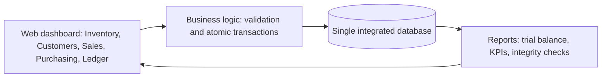
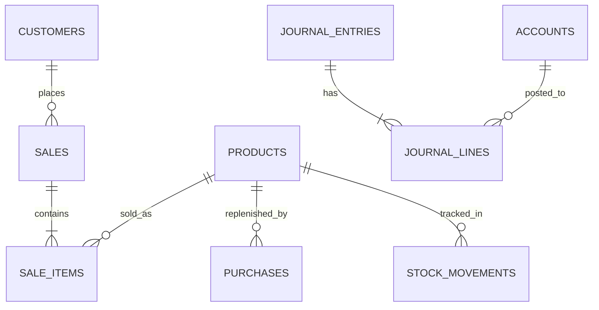

# Duka ERP: System Architecture & Database Documentation

**Organization:** a neighbourhood retail shop (groceries). **Modules:** Sales & Inventory (Materials Management) + Financials (General Ledger). **Platform:** free, browser-based single-file app (`retail-erp.html`, hosted as a Claude artifact; also runs on GitHub Pages or Replit). Production-grade DDL for Supabase (free PostgreSQL) is in `schema.sql`.

## 1. Architecture

All screens read and write one data store. There are no per-module copies of data.

## 2. ER Diagram

## 3. Cross-module data flow (the integration)

| Business event | Inventory effect | Financial effect |
|---|---|---|
| Sale completed | stock down, `sale` movement | Dr Cash / Cr Sales Revenue; Dr COGS / Cr Inventory |
| Sale voided | stock restored, `void` movement | both entries reversed |
| Stock received | stock up, weighted-average cost recalculated | Dr Inventory / Cr Cash |

Each event runs as one atomic transaction. If any step fails (e.g. insufficient stock), nothing is saved.

## 4. Validation and anti-redundancy controls

| Control | Where |
|---|---|
| Unique SKU, unique customer phone | `UNIQUE` / `chkProduct`, `chkCust` |
| No negative stock (no overselling) | `CHECK (qty_on_hand>=0)` + stock check before sale |
| Stock and cost are not directly editable | only movements change them |
| Journal must balance (debits = credits) | `post()` / deferred constraint trigger |
| Cannot delete records with history | `ON DELETE RESTRICT` / delete guards |
| Prices fixed on the sale line at time of sale | `sale_items.unit_price`, `unit_cost` |
| Inventory ledger vs stock valuation reconciliation | Dashboard integrity check / `v_inventory_reconciliation` |

## 5. CRUD coverage

| Entity | Create | Read | Update | Delete |
|---|---|---|---|---|
| Products | Inventory tab | table + movements | Edit | Delete (guarded) |
| Customers | Customers tab | table + lifetime sales | Edit | Delete (guarded) |
| Sales | Sales tab | history | Void (reversal, not edit) | not allowed (audit trail) |
| Purchases | Purchasing tab | history | n/a | n/a |
| Ledger | automatic | Ledger tab | n/a | n/a (append-only) |

## 6. Setup

**Option A (zero setup):** open `retail-erp.html` in any browser. Data persists in that browser (localStorage). "Reset to sample data" is on the Dashboard.

**Option B (Supabase):** create a free project, open SQL Editor, paste and run `schema.sql`. Insert rows into `sale_items` and `purchases` to see triggers update stock and the ledger.

**Test script:** (1) Sell 5 Rice 5kg, then check Inventory stock (35) and Ledger. (2) Try selling 999 units: rejected. (3) Void the sale: stock and ledger return to the start. (4) Add a duplicate SKU: rejected. (5) Delete a product with sales: rejected.

**Known limitations of the prototype (for your own audit):** the browser version has no multi-user concurrency or login; Option A keeps data in one browser; sales are paid in full at sale time (no receivables); COGS is rounded to whole shillings; the SQL version posts one journal entry pair per sale line.

---

# AI Support Statement (edit to match what you actually did)

> I used Claude to assist with the design and testing. I reviewed and tested the generated design.

# Prompt Log (replace with your own real prompts)

| # | Date | Tool | Prompt (summary or verbatim) | Output used | What I checked, fixed or rejected |
|---|---|---|---|---|---|
| 1 | | Claude | "Design a lightweight functional ERP prototype for a retail store using a free web platform, following the midterm instructions" | HTML prototype, `schema.sql`, this document | |

